<p align="center">
  
</p>

<p align="center">
  <a href="https://t.me/unfinitum"></a>
  <a href="https://t.me/TheEfferentBot"></a>
  
</p>

```console
$ whoami
matin hassanloo — instructor @ Istanbul Medipol University

$ cat research.txt
olfactory neural interfaces · neural signal processing · ML for odor decoding

$ cat teaching.txt
Object-Oriented Programming (Java) · C Programming

$ uptime
building something every day → t.me/unfinitum
```

## ◢◤ Projects

<table>
<tr>
<td width="50%" valign="top">

### [⟶ Efferent](https://github.com/maasker/Efferent)
Telegram-native SSH fleet manager. Terminal Mini App, keyless 5-minute certs, GPU alerts, training watch with loss curves, Jupyter tunnels.

`python` `asyncssh` `telegram-mini-app`

</td>
<td width="50%" valign="top">

### [◉ Axial](https://github.com/maasker/Axial)
macOS MRI viewer + DICOM de-identifier. Look at scans, strip patient data before sharing.

`swift` `macos` `dicom`

</td>
</tr>
<tr>
<td width="50%" valign="top">

### [♥ Pulse](https://github.com/maasker/Pulse-WebApp)
Project heartbeat tracker with a Sunday weekly review. Installable PWA, works offline.

`javascript` `pwa`

</td>
<td width="50%" valign="top">

### [◢◤ UNFINITUM](https://t.me/unfinitum)
A Telegram channel + bots for daily builds, code and papers. Releases here post themselves.

`telegram` `automation` `groq`

</td>
</tr>
</table>

## ⚡ Stack

<p>
  
</p>

## ⟵ Signals

<p align="center">
  
  
</p>

<p align="center">
  <picture>
    <source media="(prefers-color-scheme: dark)" srcset="https://raw.githubusercontent.com/maasker/maasker/output/snake-dark.svg">
    
  </picture>
</p>

<p align="center"><sub>◢◤ every commit is an action potential</sub></p>
