| RT (min) | compound | m/z | notes |
|:--:|---|:--:|---|
| `3.20` | [**Efferent**](https://github.com/sudometin/Efferent) | `ssh` | Telegram-native SSH fleet manager · keyless certs · GPU alerts · [try it →](https://t.me/TheEfferentBot) |
| `7.60` | [**Axial**](https://github.com/sudometin/Axial) | `dcm` | macOS MRI viewer + DICOM de-identifier |
| `11.6` | [**Pulse**](https://github.com/sudometin/Pulse-WebApp) | `pwa` | project heartbeat · Sunday weekly review |
| `16.0` | [**UNFINITUM**](https://t.me/unfinitum) | `∞` | daily builds, code & papers · self-posting AI bot |

<code>◢◤ sniff → spike → ship</code> · <a href="https://t.me/unfinitum">t.me/unfinitum</a>
