<picture>
  <source media="(max-width: 700px)" srcset="assets/m-odorant.svg">
  
</picture>

<picture>
  <source media="(max-width: 700px)" srcset="assets/m-chromatogram.svg">
  
</picture>

<a href="https://github.com/sudometin/Efferent"><picture><source media="(max-width: 700px)" srcset="assets/peak-1.svg"></picture></a><a href="https://github.com/sudometin/Axial"><picture><source media="(max-width: 700px)" srcset="assets/peak-2.svg"></picture></a>

<a href="https://github.com/sudometin/Pulse-WebApp"><picture><source media="(max-width: 700px)" srcset="assets/peak-3.svg"></picture></a><a href="https://t.me/unfinitum"><picture><source media="(max-width: 700px)" srcset="assets/peak-4.svg"></picture></a>

<picture>
  <source media="(max-width: 700px)" srcset="assets/m-enose.svg">
  
</picture>

<code>◢◤ sniff → spike → ship</code> · <a href="https://t.me/unfinitum">t.me/unfinitum</a> · <a href="https://t.me/TheEfferentBot">@TheEfferentBot</a>

